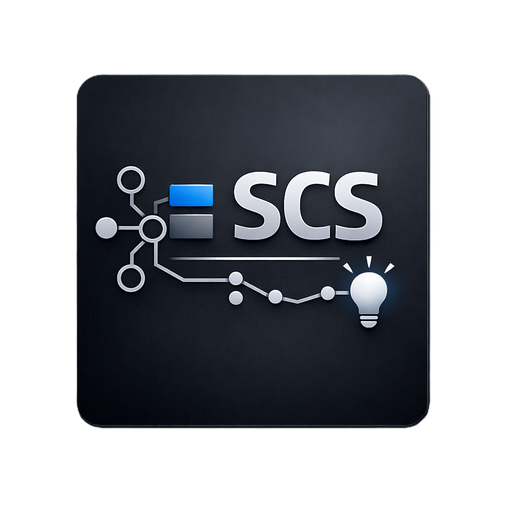

<div align="center">
  
  <h1>SCS IntelliSense</h1>
  <p>VS Code support for SCS Software mod files (American Truck Simulator / Euro Truck Simulator 2)</p>
</div>

<div align="center">
  <a href="./LICENSE.md"></a>
  <a href="https://marketplace.visualstudio.com/items?itemName=DuHNunes.scs-intellisense"></a>
  
</div>

> **Unofficial community project.** SCS IntelliSense is not affiliated with or endorsed by SCS Software. Euro Truck Simulator 2, American Truck Simulator and SCS Software are trademarks of their respective owners.

## What it is

**SCS IntelliSense** is a VS Code extension for the `.sii` and `.sui` files used by SCS Software games and mods. These files are usually edited as plain text; the extension adds highlighting, error checking and navigation, so mistakes show up while you type instead of when the game fails to load.

**Install it** from the [VS Code Marketplace](https://marketplace.visualstudio.com/items?itemName=DuHNunes.scs-intellisense), or search for **SCS IntelliSense** in the Extensions view (`Ctrl+Shift+X`).

## Features

Always on:

- 🎨 **Semantic highlighting**: class names (including namespaces such as `ui::`), unit names, attribute keys, values, comments and `@include`.
- 🔍 **Diagnostics**: structural errors (missing `:`, `{` or `}`), invalid class and unit names, duplicate unit names in a file, misplaced `@include`, missing final newline.
- 🔧 **Quick fixes** (light bulb, `Ctrl+.`) for problems with one obvious fix: a missing `:` or final newline, `a..b` in a unit name, an unmatched quote, an indented `@include`.
- 🧭 **Outline, breadcrumbs and Go to Symbol** for units, attributes and includes.
- 📂 **File icons** for SCS file types.

Experimental (off by default):

- 💡 **Completion** for `class_name` and attribute keys.
- 🖱️ **Hover** with descriptions of classes and attributes.
- ✨ **Formatter**: Format Document, plus **Check Formatting of All Files** and **Format All Files** for the whole workspace.

To turn experimental features on, open the Settings (`Ctrl+,`), search for `@ext:DuHNunes.scs-intellisense`, check the ones you want and reload the window (**Developer: Reload Window**). See the [Marketplace page](https://marketplace.visualstudio.com/items?itemName=DuHNunes.scs-intellisense) for every setting and command.

## Tested against the game

The diagnostics are checked against **all 34,843 `.sii`/`.sui` files of American Truck Simulator 1.61**, with no false errors, and the formatter was run over the same files without changing any content.

SCS's [modding wiki](https://modding.scssoft.com/wiki/Main_Page) is incomplete, and in some places the game's own files differ from it: unit names with uppercase letters or in double quotes, class names such as `ui::text`, `.sui` files that hold only attributes. When the game and the wiki disagree, the extension follows the game.

The extension hasn't been checked against Euro Truck Simulator 2's files yet.

## Schema database

Completion and hover read class and attribute information from a separate repository, [scs-schema](https://github.com/duhnunes/scs-schema), which is still being written. Contributions there are welcome: see its [contributing guide](https://github.com/duhnunes/scs-schema/blob/master/CONTRIBUTING.md).

## Reporting problems

Open an [issue](https://github.com/duhnunes/scs-intellisense/issues). The most useful report is an error on a file that **the game loads fine**: include the part of the file and its path (for example `def/world/mover.allflags.sii`).

## Development

Requirements: [Node.js](https://nodejs.org/) and [pnpm](https://pnpm.io/) 11.

```bash
pnpm install
pnpm test
```

| Command | What it does |
|---|---|
| `pnpm test` | Runs the test suite (Vitest, in `apps/server/test`) |
| `pnpm compile` | Builds everything and creates the `.vsix` in `release/latest`, without publishing |
| `pnpm release` | Maintainer only: tests, version bump, changelog, `.vsix`, GitHub release and Marketplace publish |

To run the extension from source, open the repository in VS Code and press `F5` (**Run Extension**). It builds the server and the client first, with source maps for debugging.

### Project structure

- `apps/client`: the VS Code extension. Starts the language server, handles settings and commands.
- `apps/server`: the language server. A tolerant parser reads each file into a tree; highlighting, diagnostics, Outline, formatter, completion and hover all work from that tree.
- `config`: shared ESLint and TypeScript settings.

Want to help? Start with [CONTRIBUTING.md](./CONTRIBUTING.md). The [developer docs](./docs/README.md) cover:

- [Architecture overview](./docs/architecture/overview.md)
- [The reader](./docs/architecture/reader.md): how a file becomes a tree
- [Diagnostics](./docs/features/diagnostics.md): where the rules are and how to add one
- [File format](./docs/reference/file-format.md): what the parser accepts, and where the game differs from the wiki
- [Formatter](./docs/features/formatter.md)

## License

[MIT](./LICENSE.md)
