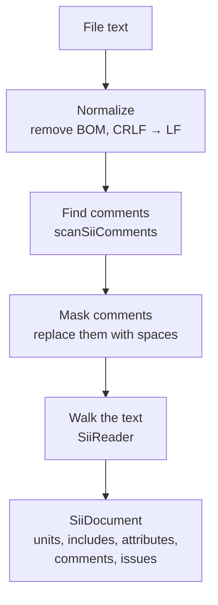
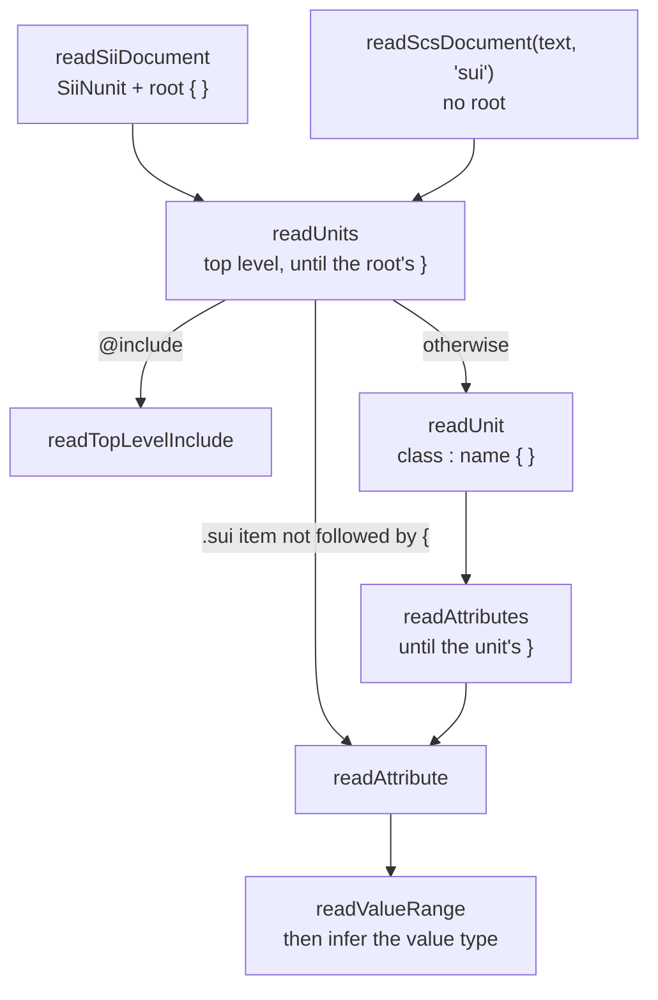
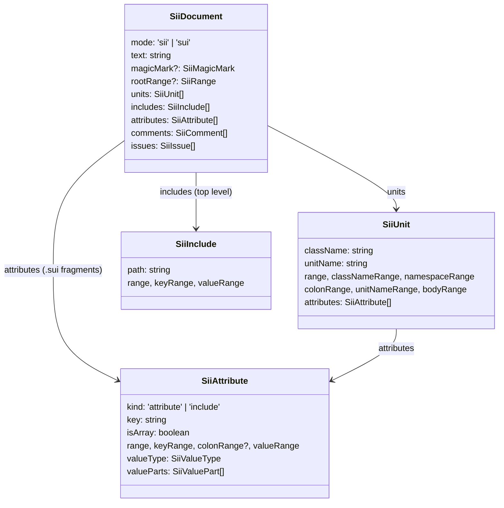

[Docs](../README.md) › Architecture › **The reader**

# The reader

`apps/server/src/sii/reader.ts` turns the text of a `.sii` or `.sui` file into a tree, `SiiDocument`. Every feature of the extension reads that tree, so this file is the base everything else stands on.

It has one job, and one thing it refuses to do:

- **It builds the tree and records where every piece is** (an offset range for each name, key, value, brace and comment).
- **It never decides whether something is allowed.** An invalid class name is still read as a class name; whether it's valid is checked later, in `diagnostic/rules.ts`. [Why](#why-it-reads-raw-and-never-judges) is explained below.

It never throws, either. Whatever the input, it returns a tree plus a list of the problems it found.

## From text to tree



1. **Normalize** (`normalizeSiiText`). A BOM at the start is removed and Windows line endings (`\r\n`) become `\n`. Every offset in the tree refers to this normalized text, `document.text`, not to the editor's original text. That's why the features convert positions through a `TextDocument` built from `document.text` ([rule 3](./overview.md#rules-that-keep-it-working)).
2. **Find comments** (`scanSiiComments`). `#` and `//` run to the end of the line; `/* */` can nest. Quoted strings are skipped, so the `#` in `text: "#1"` isn't a comment. The result is a list of `SiiComment`, each with its kind and range.
3. **Mask comments**. A copy of the text is made with every comment character replaced by a space (line breaks are kept). Parsing happens on this masked copy, so nothing inside a comment can look like code, while every offset stays exactly the same as in the real text.
4. **Walk the text** (`SiiReader`). A cursor moves through the masked text from start to end, reading one piece at a time, as described in the next section.

## How the walk works

`SiiReader` is a hand-written, top-down reader: one method per piece of the format, each calling the next.



- **`readSiiDocument`** expects the `SiiNunit` marker and the root `{`, calls `readUnits`, then reports anything after the root's `}` (a second `SiiNunit` block, for example).
- **`readUnits`** loops over the top level: an `@include` becomes an `SiiInclude`, anything else is read as a unit. In a `.sui`, an item that isn't followed by `{` (on the same line or the next one) is read as a bare attribute instead, because a `.sui` can be a fragment of a unit body ([file format](../reference/file-format.md#sui)).
- **`readUnit`** reads `class_name`, the `:`, `unit.name` and the body. A `::` inside the class name belongs to it (`ui::text`); a single `:` separates class and unit name.
- **`readAttributes`** loops over a unit body until its `}`, reading each line as an attribute or an in-body `@include`. If it meets a unit header instead, the unit's `}` is missing: it stops there so the header is read as the next unit, not as an attribute.
- **`readAttribute`** reads the key (with an optional `[]` or `[N]`), the `:` and the value, which runs to the end of the line. Quotes and parentheses are respected, so `text: "a } b"` doesn't end the unit.

After a value is read, `value.ts` **infers its type from the text alone**: quoted → `string`, `true`/`false` → `bool`, `(1, 2)` → `float2`, `.a.b` → `owner_ptr`, and so on, and splits numbers and name segments into `valueParts` for highlighting. It's a guess based on the value's shape, not on the class schema: `something` is a `token` here even if the schema says the attribute is a `string`.

## The tree



The types live in `apps/server/src/interfaces/structure.ts`. A range is `{ start, end }`, a half-open interval (`end` is exclusive) of offsets into `document.text`.

- `document.attributes` is only filled for a `.sui` that holds bare attributes; it's always empty for a `.sii`.
- An `@include` inside a unit body is an `SiiAttribute` with `kind: 'include'`; one at the top level is an `SiiInclude`.
- Comments aren't attached to units or attributes. They're one flat list, in order, and features that need them (the formatter, highlighting) place them by their range.

### An example

This file:

```
SiiNunit
{
ui::text : .my.label {
  text: "Hi" # greeting
  coords: (1, 2)
}
}
```

produces this tree (ranges are `start-end` offsets, with the text they cover):

| Field | Range | Text |
|---|---|---|
| `magicMark.range` | 0-8 | `SiiNunit` |
| `rootRange` | 9-78 | from the root `{` through its `}` |
| `units[0].range` | 11-76 | the whole unit, `ui::text` through its `}` |
| `units[0].classNameRange` | 11-19 | `ui::text` |
| `units[0].namespaceRange` | 11-13 | `ui` |
| `units[0].colonRange` | 20-21 | `:` |
| `units[0].unitNameRange` | 22-31 | `.my.label` |
| `units[0].bodyRange` | 33-75 | between the unit's `{` and `}` |
| `attributes[0]` | key 36-40, value 42-46 | `text`, `"Hi"` (`valueType: 'string'`) |
| `attributes[1]` | key 60-66, value 68-74 | `coords`, `(1, 2)` (`valueType: 'float2'`, `valueParts`: `1` at 69-70, `2` at 72-73) |
| `comments[0]` | 47-57 | `# greeting` (kind `hash`) |
| `issues` | | none |

(Generated by running the reader on that text.)

## Why it reads raw and never judges

Take a class name with a typo:

```
pref@b_model : a.b {
  k: 1
}
next : c.d {
}
```

The reader reads `pref@b_model` whole, up to the whitespace before `:`, without asking whether `@` is allowed. Then `:`, `a.b` and the body follow as usual, and the next unit is read correctly. Afterwards, `rules.ts` reports `Invalid character in className: "@"`, pointing at the `@` alone.

If the reader instead stopped at the first character that isn't valid in a class name, the cursor would stop on `@`, the `:` would never be found, and recovery would skip the rest of the line, swallowing the `{`. From there on every `}` would close the wrong block, and the whole rest of the file would be misread. Reading raw keeps the structure in sync; judging later keeps the rules simple and testable on their own. This is [rule 1](./overview.md#rules-that-keep-it-working).

## Recovering from errors

When something structural is missing, the reader records an `SiiIssue` and carries on, so one mistake doesn't hide everything after it:

| Input | What the reader does | Issue |
|---|---|---|
| `prefab_model ; a.b {` (a stray character instead of `:`) | Skips that one character and reads the header as normal | `Expected ':' between className and unitName`, on `;` |
| `prefab_model a.b {` (no `:` at all) | Sees that `a` can start a unit name, so it doesn't skip it | `Expected ':' between className and unitName` |
| `prefab_mo` (a class name still being typed) | Keeps a partial unit with the class name and its range, so highlighting and completion keep working while you type | `Expected ':' ...` and `Invalid unitName format` |
| A unit whose `}` is missing, followed by another unit | Ends the open unit where the next header starts (a line followed by `{`, which an attribute never is), then reads the next unit normally | `Expected '}' to close unit`, on the `{` of the unit left open |
| A unit still open when the file ends | Ends the unit at the end of the file | `Expected '}' to close unit`, on its `{` |
| A line it can't read at all | Skips to the next line and continues | `Expected className` or `Expected attribute key` |

Every message the reader can produce is listed in [diagnostics](../features/diagnostics.md#from-the-reader-all-error).

## Changing the reader

- Keep it about structure. A new check on names or values belongs in `rules.ts` ([adding a rule](../features/diagnostics.md#adding-a-rule)).
- Never move the cursor based on validity, only on structure (whitespace, `:`, `{`, `}`, line ends).
- Add a test in `apps/server/test/reader.test.ts`, and if the change touches recovery, a case where the input is broken: the units *after* the broken one must still be read.
- `fixtures.test.ts` must keep passing: the excerpts of real game files must parse with no errors.

---

← [Overview](./overview.md) · [Diagnostics](../features/diagnostics.md) →
